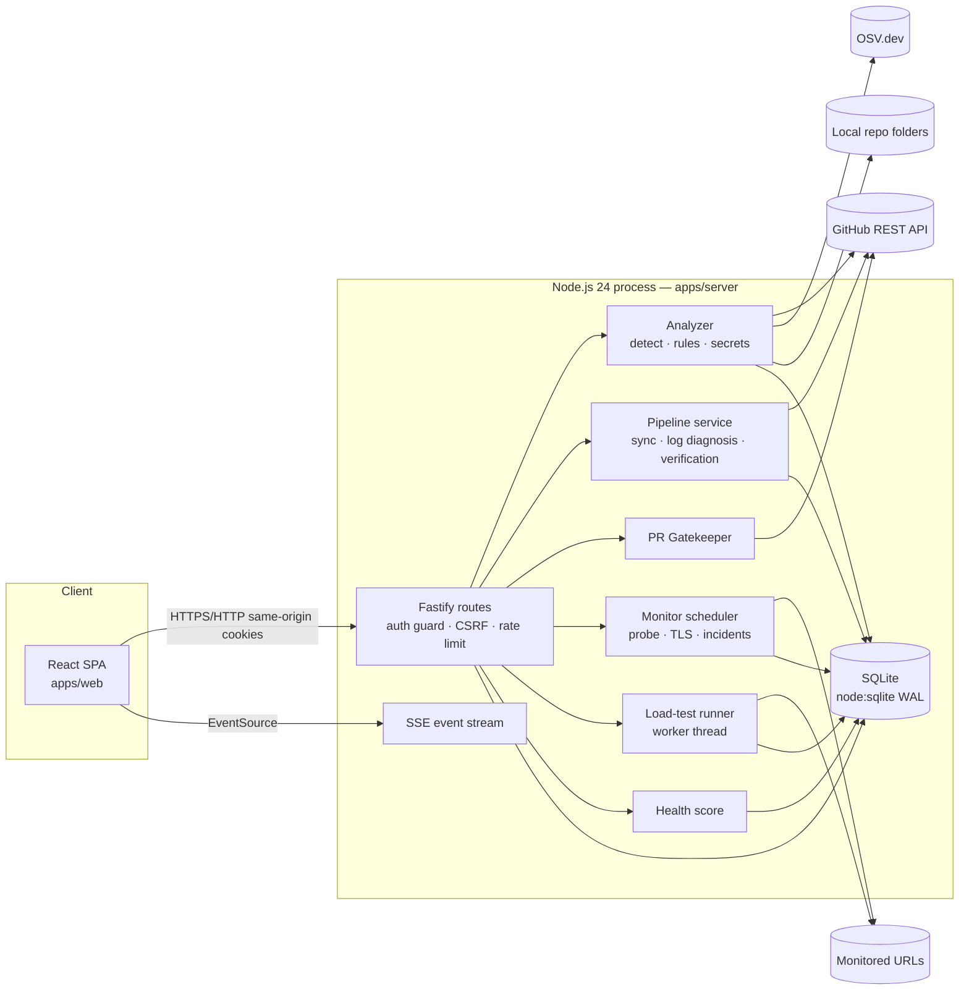

# Architecture

## Overview

The desktop app (`apps/desktop`) is an Electron shell that imports the bundled server (`dist/server.mjs`) into its main process, listens on `127.0.0.1:<random port>`, and loads the UI from it in a sandboxed window.

## Components

| Component | Responsibility | Notes |
|---|---|---|
| `auth/service.ts` | setup token, users, sessions, invites, lockout | tokens stored as SHA-256; scrypt passwords |
| `analysis/source.ts` | uniform file access for GitHub trees and local folders | local: no symlinks, path-traversal guard, 20k-file cap; remote: content API |
| `analysis/detect.ts` | languages, frameworks, manifests, CI, Docker/IaC, docs, deploy targets | read-only heuristics |
| `analysis/rules.ts` | secrets, GitHub Actions, Dockerfile, Terraform, Kubernetes, hygiene rules | evidence redacted; findings fingerprinted by hash |
| `analysis/osv.ts` | dependency extraction (npm lockfiles, pinned PyPI, Go modules) + OSV queries | only package/version triples leave the machine |
| `analysis/diagnose.ts` | deterministic CI log classification with cited lines | first meaningful error wins; cascading lines ignored |
| `analysis/pipelines.ts` | GitHub Actions sync, job-log diagnosis, fix verification, pipeline incidents | bounded: 300 runs, 10 diagnoses per sync |
| `analysis/gatekeeper.ts` | PR rules from metadata/diffs | never executes PR code |
| `monitoring/*` | HTTP probes, TLS/DNS, scheduler (≥ 60 s, 4 concurrent), site scans | incidents after N failures; recovery auto-resolves |
| `loadtest/*` | closed-loop VUs in a worker thread with caps and auto-abort | remote targets need monitor + ownership confirmation |
| `health.ts` | System Health Pulse | see HEALTH-SCORE.md |
| `lib/events.ts` | activity events + SSE fan-out + audit log | events purged after 90 days |

## Data model (SQLite)

`users`, `sessions`, `invites`, `settings`, `audit_log`, `repositories`, `analyses`, `findings`, `workflow_runs`, `run_diagnoses`, `monitors`, `checks`, `incidents`, `events`, `site_scans`, `load_tests`, `health_snapshots`. Migrations are append-only in `db.ts`. Indexes cover the hot paths (findings by status/severity, runs by repo/time, checks by monitor/time, incidents by status). Source code is never stored — only metadata, findings with redacted evidence, and short redacted log excerpts.

## API (summary)

All under `/api`, JSON, cookie session, `X-CSRF-Token` on mutations.

- Public: `GET /health`, `GET /auth/status`, `POST /auth/setup|login|accept-invite` (rate-limited 10/min/IP).
- Any role: `GET` of everything below, `POST /auth/logout`, `POST /auth/password`, `GET /events/stream` (SSE).
- Admin: `POST/DELETE /repositories`, `POST /repositories/:id/analyze`, `POST /repositories/:id/pipelines/sync`, `POST /pipelines/runs/:id/diagnose`, `POST /findings/:id/suppress|unsuppress`, `POST /repositories/:id/pulls/:n/evaluate|comment`, monitors CRUD + `/check`, `POST /sites/scan`, incidents create/ack/resolve/notes, load tests start/stop/import, `PUT /settings`, users/invites, `GET /audit`.
- Reads: `/overview`, `/health-score`, `/analytics` (+ `/analytics/export.csv`), `/repositories[/:id[/architecture|/deployments|/pulls]]`, `/pipelines/runs[/:id]`, `/findings`, `/monitors[/:id]`, `/sites/scans[/:id]`, `/incidents[/:id]`, `/load-tests[/:id]`, `/events`, `/search`, `/settings`, `/system`.

## Scalability design

- Stateless request handling apart from SQLite; pagination and `LIMIT` on every list; bounded background work (scheduler concurrency 4, analysis per repo serialised, one load test at a time).
- One SSE connection per tab (≤ 5 per user, ≤ 1000 total) instead of polling; clients refetch only invalidated topics, debounced.
- Rate limits: 600 requests/min per session (per IP when anonymous); `/api/health` exempt.
- Scaling beyond one process would need a shared database (e.g. Postgres) and a single scheduler leader; this is intentionally not built for the ₹0 local-first target. Measured limits are in LOAD-TEST-RESULTS.md.
